# TT_ChatChoice — 把 RPG Maker 的对话选项换成聊天框

版本 **0.1.4** · 2026-11-10 · RPG Maker **MV / MZ** 通用 · 以 OMORI 这类游戏为设计目标

仓库：<https://github.com/silversystem04-coder/rpgmaker-chatbox> · 自测 49 项全过

游戏弹出选项时，插件把原选项窗口藏起来，在屏幕底部开一个聊天框：上面小字列着原选项，玩家用自己的话说；插件先在本地做语义匹配（序数 / 是非 / 词面 / 中文 bigram），有把握就显示「我理解为：第 X 个『…』」，**按 Enter 确认后**才替你点原来的按钮。按 Esc 随时退回原选项。F9 全局开关。

> 铁律：**不静默替玩家选**。没把握就不猜，让玩家走原路。

## 下载

- **最新发布（插件 zip / 演示视频 / 封面）**：<https://github.com/silversystem04-coder/rpgmaker-chatbox/releases/latest>
- 直接下插件包：<https://github.com/silversystem04-coder/rpgmaker-chatbox/releases/latest/download/rpgmaker-chatbox.zip>
- 演示视频：<https://github.com/silversystem04-coder/rpgmaker-chatbox/releases/latest/download/tt_chatchoice_film.mp4>


## 截图

| 打开聊天框 | 匹配 + 确认 | 确认后游戏继续 |
| --- | --- | --- |
| 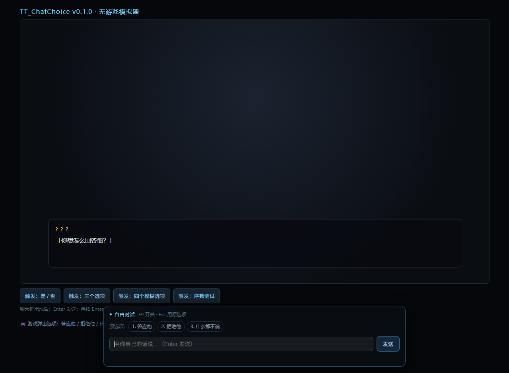 | 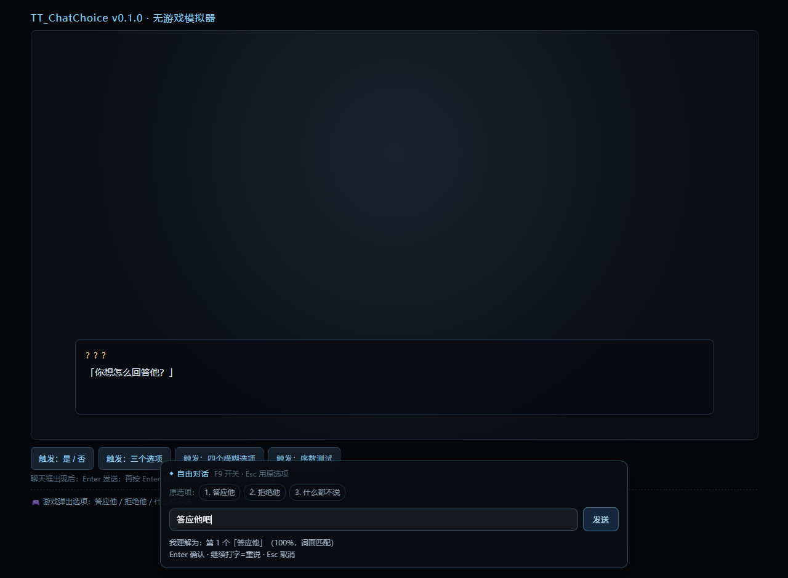 | 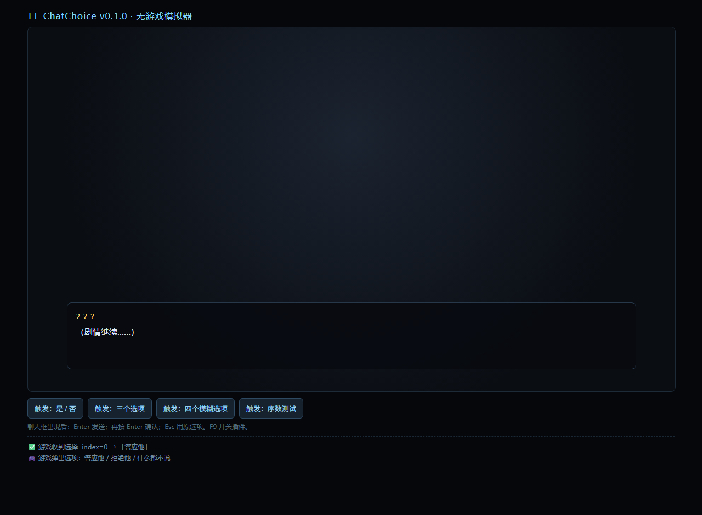 |

| 没把握 → 给候选 | 点原选项 → 确认 | 两次没听懂 → 升级提示 |
| --- | --- | --- |
| 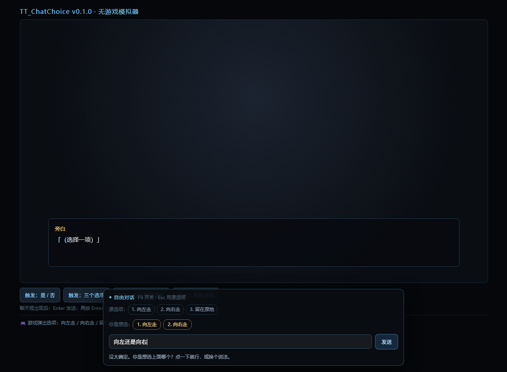 | 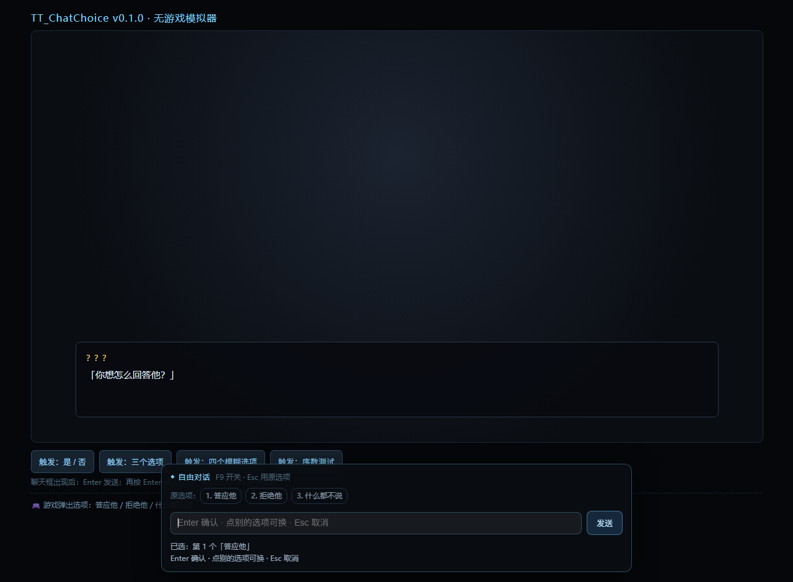 | 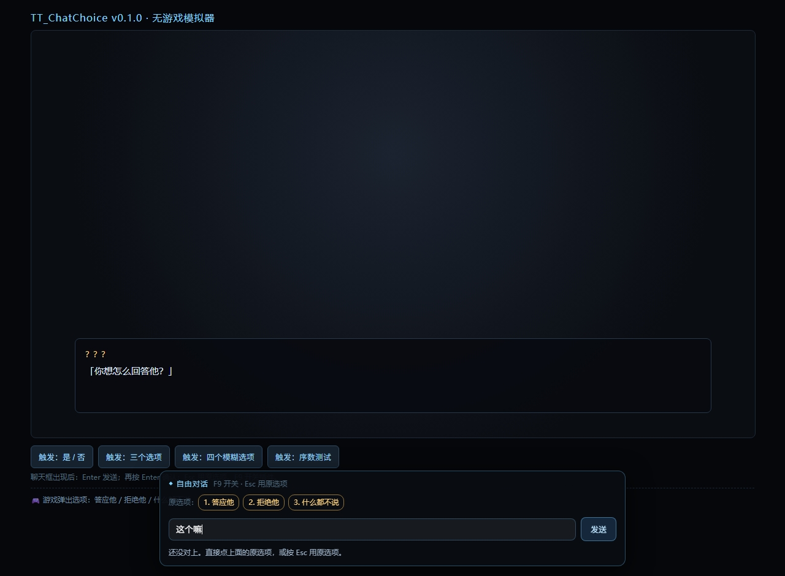 |

| 真机 OMORI：真实选项被聊天框接管 | 真机：拖到左下 + 缩放，不压原对话框 |
| --- | --- |
| 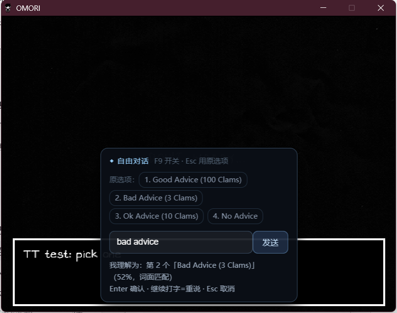 | 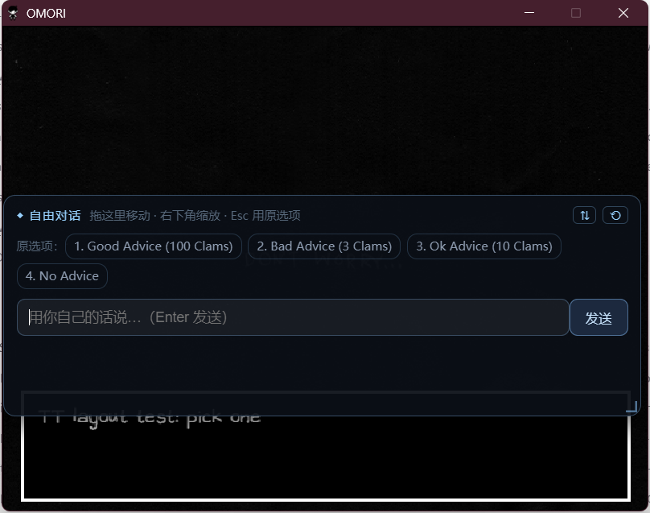 |

| 小窗口默认停顶部（mock，430×118） | 大窗口默认停底部（mock，560×150） |
| --- | --- |
| 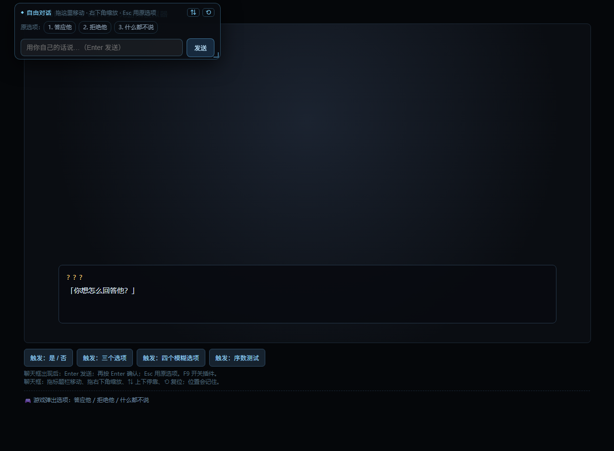 | 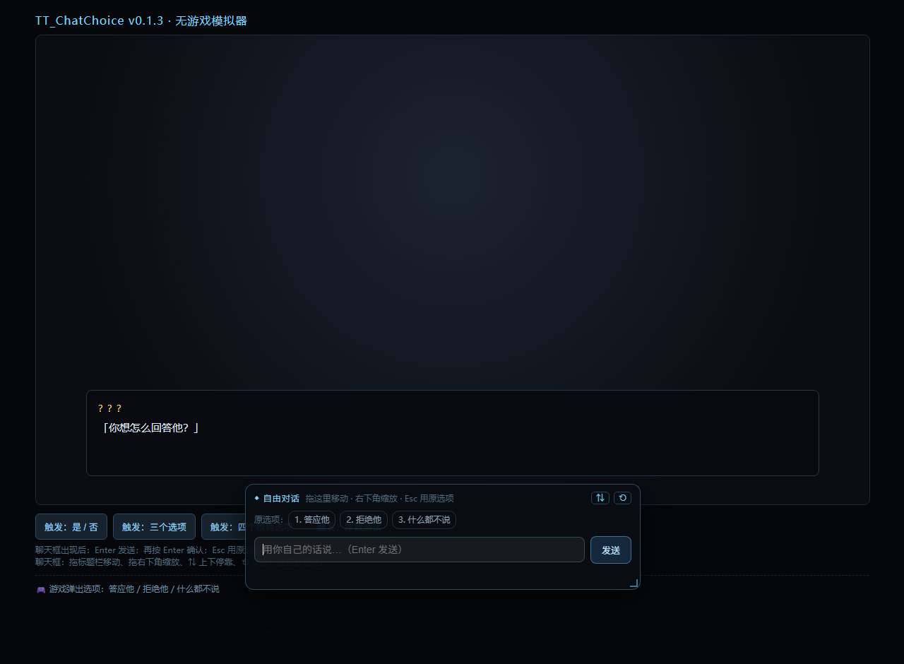 |

| 大模型兜底：本地没把握 → 问接口（mock 接口，70% 大模型） |
| --- |
| 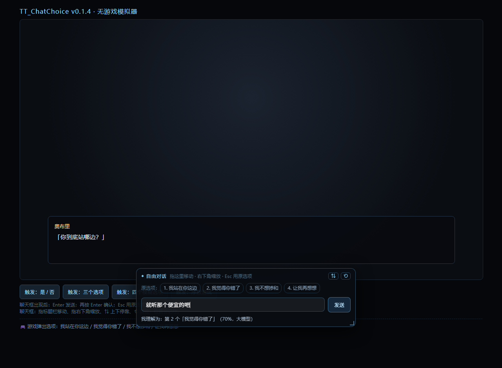 |

（mock 截图来自 `mock/index.html` 无游戏模拟器；OMORI 两张是实机窗口截图。）

## 安装

### 一键安装（推荐，Windows）

```powershell
powershell -NoProfile -ExecutionPolicy Bypass -File .\tools\install-omori.ps1 -GameDir "<游戏根目录>"
```

脚本会自己判断游戏用哪种加载器：

- **普通 MV/MZ**：把插件复制进 `<js>/plugins/`，在 `plugins.js` **末尾追加** `$plugins.push(...)`，备份 `plugins.js.bak-时间戳`。重复运行不会重复添加。
- **加密插件游戏（OMORI）**：OMORI 的 `main.js` 会把每个插件名映射成 `.OMORI` 加密文件再解密，普通 `.js` 插件条目会报 `ENOENT ... TT_ChatChoice.OMORI`。脚本检测到 `.OMORI` 后自动改走 **index.html 注入**：在 `rpg_windows.js` 之后插入 `<script src="js/plugins/TT_ChatChoice.js"></script>`，插件自己挂 hook。备份 `index.html.bak-时间戳`。

恢复 = 把对应 `.bak-时间戳` 文件改名覆盖回去。

### 手动装（普通 MV）

1. 把 `js/plugins/TT_ChatChoice.js` 复制到 `<游戏目录>/www/js/plugins/`
2. 编辑 `<游戏目录>/www/js/plugins.js`，文件末尾加一行：

```js
$plugins.push({"name":"TT_ChatChoice","status":true,"description":"","parameters":{}});
```

3. 启动游戏。选项出现时底部应出现聊天框；按 F9 可看到「自由对话 开/关」提示。
   没有反应 = 插件没加载：F12 打开控制台看报错（**别用正则改 `var $plugins = [...]` 数组正文**，参数里带 `];` 会把文件改崩）。

### OMORI 手动装（加密插件）

1. 复制 `js/plugins/TT_ChatChoice.js` 到 `<游戏目录>/www/js/plugins/`
2. 编辑 `<游戏目录>/www/index.html`，在 `rpg_windows.js` 的 `<script>` 之后加：
   `<script src="js/plugins/TT_ChatChoice.js"></script>`
3. **不要**往 `plugins.js` 里加条目（会报 `ENOENT ... .OMORI`）

### RPG Maker MZ

路径是 `<游戏目录>/js/plugins/`，`plugins.js` 结构相同。MZ 未实机验证。

## 用法

- 选项出现 → 聊天框自动弹出，原选项变成顶部 chips（`1. 答应他  2. 拒绝他 …`），**chips 可直接点**
- **序数**：直接说「第二个」「选 3」「2」
- **是非题**：「好 / 算了 / 嗯 / 不了」自动映射到是/否
- **其他**：正常说人话，走词面匹配（「答应他吧」→「答应他」）
- `Enter` 发送 → 再 `Enter` 确认 → 游戏继续；确认阶段继续打字 = 重说
- **没听懂时**：先说「没太听懂，换个说法？」并给两个候选（黄色可点）；连续两次没对上，chips 变黄并提示直接用原选项
- **放弃指令**（「随便 / 你帮我选 / 跳过」）：不替你选，提示按 Esc 或用原选项
- 空输入/纯符号：静默忽略，不打扰
- `Esc` = 用原选项；`F9` = 插件开关

### 调位置 / 调大小（v0.1.3）

- **拖标题栏**移动聊天框；**拖右下角**缩放（最小 300×96）
- 标题栏右侧两个按钮：`⇅` 在顶部/底部之间停靠，`⟲` 复位到默认位置和大小
- 小窗口（高 < 560，比如 OMORI 的 640×480）**默认停顶部**，不再压住底部的原版对话框
- 位置和大小按游戏分别记在 `localStorage`（键名可在 `layoutKey` 改），下次打开还是你放的样子

## 配置（`TT.CONFIG`，文件开头）

| 字段 | 默认 | 说明 |
| --- | --- | --- |
| `enabled` | `true` | 插件总开关（F9 也会改它） |
| `minScore` | `1` | 本地匹配最低分，低于它就不猜 |
| `minConfidence` | `0.5` | 最低置信度（0–1） |
| `confirm` | `true` | 先确认再选；`false` = 直接选（不推荐） |
| `hideOriginal` | `true` | 隐藏游戏原选项窗口 |
| `hotkey` | `'F9'` | 开关热键 |
| `pollFallback` | `true` | 400ms 轮询兜底（hook 失效时用） |
| `layoutKey` | `'TT_ChatChoiceLayout'` | localStorage 里记布局的键名（想不同存档分开就改） |
| `defaultDock` | `'auto'` | `'auto'` = 小窗口（高<560）默认停顶部；`'top'` / `'bottom'` 强制 |
| `defaultWidth` | `560` | 首次出现宽度（px），窗口更窄会自动收 |
| `defaultHeight` | `150` | 首次出现高度（px） |
| `minWidth` | `300` | 缩放下限 |
| `minHeight` | `96` | 缩放下限 |
| `debug` | `false` | 控制台打日志 |
| `api.enabled` | `false` | 开启后本地没把握时调大模型 |
| `api.endpoint` | DeepSeek | `https://api.deepseek.com/chat/completions`（任何 OpenAI 兼容接口都行） |
| `api.key` | `''` | 你的 key；**建议别写在这里**，用下面的 key 文件或 localStorage（明文写进游戏文件，别分享游戏目录） |
| `api.model` | `'deepseek-chat'` | 模型名 |

接了大模型后，单次选择约 700 输入 token + 30 输出 token，DeepSeek 按量约 **¥0.0015/次**，一局 200 次 ≈ ¥0.3。

## 接大模型（v0.1.4）

本地规则够用时**永远不会联网**；只有本地没把握、且 `api.enabled = true`、且能找到 key 时才发一次请求。请求失败/超时（8 秒）会自动回到"没听懂，换个说法"，不会卡住游戏。

### 1. 填 key（三选一，优先级从高到低）

| 方式 | 怎么弄 | 适合 |
| --- | --- | --- |
| `TT.CONFIG.api.key` | 直接改插件文件开头 | 图省事，但 key 明文在插件里 |
| key 文件 | 把 `js/plugins/TT_ChatChoice.key.example.js` 复制成 `TT_ChatChoice.key.js`，填 `window.TT_CHAT_KEY = 'sk-...'`，在 `index.html` 里插件 `<script>` **之后**加一行 `<script src="js/plugins/TT_ChatChoice.key.js"></script>` | 推荐；换游戏只拷插件 + key 文件 |
| localStorage | 控制台执行 `localStorage.setItem('TT_ChatChoiceKey','sk-...')` | 临时测试，换浏览器就没了 |

`TT_ChatChoice.key.js` 已写进 `.gitignore`，不会被提交。

### 2. 开开关

改 `TT.CONFIG.api`：

```js
api: {
  enabled: true,        // 打开大模型兜底
  endpoint: 'https://api.deepseek.com/chat/completions',
  key: '',              // 用 key 文件的话留空
  model: 'deepseek-chat',
  timeoutMs: 8000
}
```

任何 **OpenAI 兼容** 接口都能用：换 `endpoint` + `model` 即可（通义、智谱、Kimi、本地 Ollama 的 `/v1/chat/completions` 都行）。

### 3. 自检通道

游戏或浏览器控制台执行：

```js
TT_ChatChoice.testAPI().then(console.log, console.error)
// 成功：{ ok: true, reply: "pong", usage: {...}, model: "deepseek-chat" }
// 失败：明确告诉你 没 key / endpoint 空 / HTTP 401 / 网络错误 / 超时
```

### 4. 不花钱先验一遍

```bash
node tools/mock-llm-server.mjs            # 本地假接口，127.0.0.1:8123
```

浏览器打开 `mock/index.html?auto=llm&api=1&endpoint=http://127.0.0.1:8123/v1/chat/completions`，会走完整的大模型分支，确认态显示「（70%，大模型）」。

> 安全：key 等于钱。别把带 key 的游戏目录/截图发出去；仓库里只有 example，没有真 key。

## 自测（不需要游戏）

```bash
node tools/test-core.mjs     # 纯逻辑单测，49 项
node tools/mock-llm-server.mjs   # 可选：本地大模型假接口（127.0.0.1:8123）
```

无游戏模拟器：直接用浏览器打开 `mock/index.html`，点按钮模拟选项。
自动演示参数：`?auto=1`（打开聊天框）、`?auto=confirm`（再自动输入一次）、`?auto=apply`（再自动确认，验证游戏收到选择）、`?auto=cand&case=ordinal`（故意说不清，触发候选）、`?auto=chip`（点原选项 chip 再确认）、`?auto=fail`（连续两次听不懂，触发升级提示）、`?auto=llm&api=1&endpoint=...`（强制走大模型）、`?selftest=1&api=1&endpoint=...`（只测通道，结果显示在标题上）。

```bash
# headless 截图（把路径换成你的绝对路径）
msedge --headless=new --disable-gpu --hide-scrollbars --window-size=1280,940 \
  --virtual-time-budget=4000 --screenshot=shots/chat-applied.png \
  "file:///C:/.../rpgmaker-chatbox/mock/index.html?auto=apply&case=three"
```

## 已验证 / 未验证

- ✅ mock 闭环：选项弹出 → 聊天框 → 输入「答应他吧」→ 100% 词面匹配 → Enter 确认 → 游戏收到 `index=0`「答应他」→ 剧情继续
- ✅ 49 项单测（序数 / 是非 / 词面 / 边界 / 注入 / LLM 辅助 / 配置 / 无关输入 / 放弃指令 / 候选排序 / 布局夹取 / key 解析）
- ✅ 无关输入闭环（截图）：说不清 → 给 Top-2 候选可点；点原选项 chip → 确认态；连续两次失败 → chips 变黄 + 升级提示
- ✅ **OMORI 实机端到端**（2026-11-10，真游戏窗口）：真实选项窗弹出 → 插件接管并显示聊天框 → 输入 `bad advice` → 匹配「第 2 个 Bad Advice (3 Clams)」52% → Enter 确认 → 游戏真实 onChoice 收到 `index=1`（`CALLBACK idx=1`）
- ✅ **OMORI 实机布局**（v0.1.3，2026-11-10）：480 高的窗口里默认停顶部（`top:8`）不压原对话框；合成拖拽后到 `left:1, top:168`、再拖右下缩放到 `634×220`，截图 `shots/omori-layout-dragged.png`
- ✅ OMORI 加密插件加载器已适配（index.html script 注入，见安装节）
- ⚠️ OMORI 实机踩到的坑：旧 NW.js 里插件最初创建的 UI 根节点不参与合成（`display:block` 却不显示）；**v0.1.2 起每次选项出现时重建 UI 根节点**，问题消失。
- ⬜ MZ 未实机；被游戏自定义插件改写过的 `Window_ChoiceList` 未测（若选项是图片/自定义控件，hook 可能无效，先看 `debug` 日志）
- ✅ **大模型通道（v0.1.4，用本地 mock 接口验证）**：`TT_ChatChoice.testAPI()` 返回 `{ok:true, reply:"…"}`；`?auto=llm&api=1` 走完整分支，确认态显示「第 2 个「我觉得你错了」（70%，大模型）」，截图 `shots/chat-llm.png`
- ⬜ 大模型通道**真实 key 未联调**（本机没有 DeepSeek key）：填好 key 后先跑 `TT_ChatChoice.testAPI()`，能回 `pong` 就成了

## 已知限制

- 只解决"选哪个"，不理解剧情。语义重叠的选项（如「好」vs「好吧」）本地规则会犹豫，宁可不猜
- 游戏必须在选项出现时暂停（OMORI 是；限时选项的游戏不要用）
- 商业游戏 EULA：自己玩可以，**别拿去卖**；联网/反作弊游戏不碰
- OMORI 这类游戏窗口是 640×480：v0.1.3 起默认停顶部；想盖住下方对话框就拖上去，位置会被记住

## 文件结构

```
rpgmaker-chatbox/
├─ js/plugins/TT_ChatChoice.js          # 插件本体（ES5 单文件，MV/MZ 通用）
├─ js/plugins/TT_ChatChoice.key.example.js  # key 文件模板（复制成 *.key.js 填自己的）
├─ mock/index.html                      # 无游戏模拟器（假 $gameMessage / Window_ChoiceList）
├─ mock/_dbg.html                       # 排查 UI 不显示用的最小调试页（--dump-dom 用）
├─ tools/test-core.mjs                  # 纯逻辑单测（49 项）
├─ tools/mock-llm-server.mjs            # 本地 OpenAI 兼容假接口（验证大模型通道，不花钱）
├─ tools/install-omori.ps1              # Windows 一键安装（自动识别普通/加密加载器）
├─ shots/                               # 验证截图（mock + OMORI 实机）
└─ README.md
```
